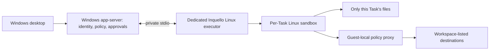

# Strict Windows execution through WSL 2

Planning date: 2026-10-29. Owner selected strict folder isolation and required all temporary files and VM storage on D:. The owner approved [the spec](../spec-1-21-wsl-execution-backend.md) and continuing implementation on 2026-10-30.

## Architecture

Use a dedicated WSL 2 distribution named `Inquello-Engine`. Keep the app-server, identity stores, provider keyring and model requests on Windows. Run the pinned fork's `codex exec-server --listen stdio` in the guest. Stdio avoids opening a host-facing executor port; it is a trusted control channel and must not be inherited or reachable by a workload. Launcher stdout contains protocol traffic only.

WSL provides the Linux environment; the existing Linux sandbox must still isolate every Task using restricted filesystem mounts, process/network namespaces and seccomp. Guest system tools are read-only. Other Task directories, executor state, guest home credentials, host drives, WSL interop/GUI sockets, management sockets and the control channel are inaccessible. Workloads run unprivileged, without sudo or capabilities that permit remounting or privilege escalation. A failed capability/readiness probe means unavailable, never execution without sandboxing.

The network proxy runs in the guest outside the workload's isolated network namespace. Preserve the runtime's managed proxy path and domain checks; do not expose all guest/Windows loopback to solve routing. Test direct IPv4/IPv6, DNS, localhost, Windows host gateway, metadata/private addresses, other Tasks' proxy listeners and inherited proxy variables. No provider credential is forwarded. Tool networking that needs host-stored authentication is unavailable until separately designed.

## Storage contract

| Purpose | Planned location |
|---|---|
| Distribution and its ext4 VHDX | `D:/Inquello/wsl/Inquello-Engine/` |
| WSL shared swap | `D:/Inquello/wsl/swap.vhdx` |
| Verified images and package manifests | `D:/Inquello/cache/images/` |
| Provisioning/transfer staging and host temp | `D:/Inquello/tmp/` |
| Recovery images and explicit backups | `D:/Inquello/backups/` |
| Setup/guest lifecycle logs | `D:/Inquello/logs/` |
| Current development/test temp | `D:/Projects/inquello/.tmp/` |
| Guest files, `/tmp`, package caches and Cargo output | Inside the D-backed VHDX; never backed by a C-drive share |

Use explicit `wsl --import` install location; do not use a default Store install location. Before the first guest launch, inspect its registered `BasePath` and actual VHDX, resolve host paths/reparse points, and reject anything outside D:. Set host `TEMP`, `TMP`, `TMPDIR` and tool caches explicitly for every provisioning/build child. No spillover to C: if D: is missing, full or inaccessible.

Start with a dynamically allocated guest disk capped at 128 GiB and 4 GiB shared swap on D:. Stop new provisioning/builds below 32 GiB free host space; check transfer quotas before staging. Capacity increases require a deliberate plan update. Disk caps, sparse allocation and free-space measurements must be verified against the installed WSL commands rather than inferred from directory names. Avoid retaining duplicate debug builds; guest Cargo uses the locked workspace, `CARGO_INCREMENTAL=0`, `-j 4` and reduced development debug information.

WSL configuration/registration metadata may reside in Windows' required profile/registry locations; no guest payload, VM disk, swap, download cache or temporary payload belongs there. Guest crash dumps must be disabled or routed to D: and checked during the storage probe. Do not claim that Windows itself performs zero C-drive logging.

WSL swap is global across distributions. This host currently has no `.wslconfig`, so its default swap location would violate the requested placement. Prepare a minimal `.wslconfig` change selecting the D: swap path and disabling WSL VM crash dumps. Preserve any settings added meanwhile; do not change Docker's disk, default distribution, memory allocation or networking mode. If applying the configuration requires a shared WSL restart, show that concrete impact and wait for a suitable user-approved restart window. Do not automatically stop Docker or run `wsl --shutdown`. Do not start the new guest until the active storage configuration is proven correct.

Per-guest `/etc/wsl.conf` disables automount, fstab processing, Windows executable interop and Windows PATH injection. Do not enable WSLg for workloads; sandbox mount construction excludes any shared WSLg/control paths even if the host has WSLg installed. Guest installation is separate from Docker's managed distribution.

Microsoft documents explicit import locations in [custom distribution import](https://learn.microsoft.com/en-us/windows/wsl/use-custom-distro), and global swap versus per-distribution mount/interop settings in [WSL configuration](https://learn.microsoft.com/en-us/windows/wsl/wsl-config). Verify actual host behavior before accepting the backend.

## Files, modes and data governance

Bind a Task to an opaque execution-environment ID. Linux absolute paths travel as file URIs; they are resolved only by Linux. Never translate arbitrary renderer paths or canonicalize Linux paths using Windows APIs.

Keep authoritative bounded-Task files in the guest. Import existing host Task files through a trusted broker, verify contents before switching the binding, and keep the old source recoverable. There is no automatic migration deletion. All file operations, export and deletion use the same Task ownership/policy checks as execution; do not add an unrestricted file API to the renderer.

Transfers accept bounded regular-file/directory streams, not archive extraction controlled by the guest. Check relative names, traversal, Windows reserved names, alternate data streams, case/Unicode collisions, quotas and overwrite rules. Never follow symbolic links, hard links, reparse points or devices across the boundary. Unsupported entries produce a clear refusal; source data remains intact. Linux-local symlinks may remain inside the guest and are subject to the sandbox. Interrupted transfers stay uncommitted and recoverable in D: staging.

Preserve existing explicit Windows Full access semantics. Switching a guest Task to that mode is an explicit Linux-to-Windows transition, with the existing broad-access confirmation and a verified file transfer to its host Task store. Switching back imports the resulting Task files under the same transfer checks. Serialize transfers, mode switches and execution per Task; block a transition with unresolved/unsupported files. Never silently reinterpret Full access as unrestricted access only inside the guest.

Extend the data register for guest Task content, runtime logs/state, caches and guest registration/recovery metadata. Export Task data through the broker, not the whole VHDX. Stop owned workloads before deletion; guest unavailability must produce a pending/failed deletion rather than claiming success. Unregistering a distribution destroys its disk and is never an automatic repair step.

## Implementation map and proof order

1. **Provisioning and storage proof.** New `desktop/scripts/wsl/` scripts produce a locked image/build manifest, preview host configuration, import on D:, configure the guest, and validate disk/swap/temp locations. First prove an unprivileged, sandboxed command cannot reach host/other-Task files or interop. Do this before desktop routing changes.
2. **Execution bridge.** `app-server/src/request_processors/command_exec_processor.rs` currently requires a local environment and joins paths on Windows. Add explicit Inquello Task routing in `inquello_processor.rs`/`message_processor.rs`; reuse `exec-server/src/client_transport.rs`, `environment_toml.rs` and `remote_process.rs`. Always attach the restricted `ExecParams.sandbox`; its absence currently means direct execution. Preserve actual argv approval, output, stdin, exit status, timeout and cancellation.
3. **Portable policy.** Reuse `exec-server-protocol/src/protocol.rs` (`ExecParams`), `file-system/src/lib.rs` (`FileSystemSandboxContext`) and `utils/path-uri/src/lib.rs` (`PathUri`). Build foreign-executor permissions without `PathUri::to_abs_path` on Windows; resolve them in Linux. `exec-server/src/process_sandbox.rs` owns executor-side enforcement.
4. **File bridge.** Reuse `remote_file_system.rs` and `sandboxed_file_system.rs`, with mandatory Task sandbox context, for guest file operations. Connect desktop `policy/tools.ts`, `data/` and the data register to guest content and transactional migration/mode switching.
5. **Lifecycle and networking.** Reuse `network-proxy/src/remote_config.rs` for guest-local proxy launch and controller policy callbacks. Credential resolution there occurs on the executor; it is not a Windows credential tunnel. Stdio disconnect handling exists, but prove guest-side descendant termination; killing `wsl.exe` alone is insufficient. No reattach to old processes with stale policy.
6. **Acceptance.** Run real isolation, network-bypass, transfer, storage, crash/restart and cancellation tests. Then rebuild all required binaries, regenerate schema if needed, run the full desktop gate and all 13 seeded smoke reports. Story 1.21 remains in progress until those gates pass.

## Proposed download/install inventory

Approval of the implementation spec authorizes one dedicated amd64 Ubuntu 24.04 LTS guest from Canonical's [Ubuntu Base release directory](https://cdimage.ubuntu.com/ubuntu-base/releases/noble/release/). Before downloading, record the exact published filename, signed checksum verification and digest in the manifest; do not consume a floating image during subsequent builds.

Inside that guest only: install build-essential, pkg-config, libssl-dev, libcap-dev, clang, cmake, git, curl, ca-certificates, python3, tar, gzip and xz-utils, plus their package-manager dependencies from authenticated Ubuntu repositories. Record resolved versions. Install the repository-pinned Rust toolchain for Linux and fetch only dependencies allowed by the existing Cargo.lock. Build the fork's Linux CLI, exec-server path and bundled bubblewrap. No Docker image pull, new Windows WSL/kernel installation or update, unrelated developer package, model download or dependency-version change is included. Any unexpected prerequisite requires a revised inventory before download.

## Planning evidence and limits

Read-only host inspection: WSL 3.0.3.0, kernel 6.18.54.1-1, Windows build 26100.33650; approximately 32 GiB RAM, 16 logical processors and 380.8 GiB free on D:. Only Docker's WSL distribution is registered. No guest was started or installed and no settings changed during planning.

This is a design, not enforcement evidence. User namespaces, seccomp, proxy isolation, lifecycle cleanup and D-only storage still require real probes on this host. If WSL cannot satisfy them, retain unavailable status and return with evidence for a dedicated VM design; do not silently change the isolation contract.
