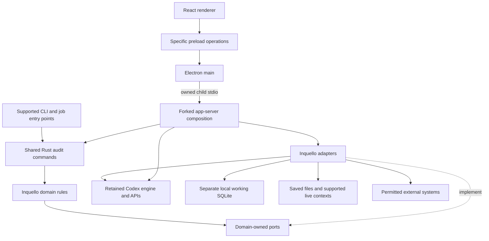

# Architecture Spine — Inquello

## Design Paradigm

**Layered modular Rust domain with ports and adapters**, surrounding the retained Codex engine/app-server and an Electron React/TypeScript desktop client. This names the adopted AD-1–4 boundaries; it adds no framework or network-service decision. Shared audit modules own domain rules; adapters connect runtime, persistence, files and external systems; clients expose the supplied UX.

This initiative contract binds independently implemented features. The full target retains **41 V1 FRs and three V2 FRs (38, 40, 42)**, all applicable NFRs, eight source journeys and the PRD's detailed inventory. Source reconciliation and all four review lenses are complete; the resulting contract corrections are incorporated. Nothing here claims implemented capability, runtime validation or release approval.

Arrows below denote allowed dependencies; dashed arrows denote port implementation. The composition host wires implementations. Domain modules do not import Electron or concrete runtime/storage adapters.



## Invariants & Rules

AD-1–4 are user-adopted choices. AD-5–14 derive enforcement rules from those choices and the governing PRD/UX; their rationale and source accounting live in the [memlog](.memlog.md).

### AD-1 — Public Codex fork foundation [ADOPTED]

- **Binds:** All runtime-dependent features.
- **Prevents:** Independent replacement engines and an invented greenfield foundation.
- **Rule:** Derive Inquello from public `openai/codex`; inherit verified runtime/app-server contracts at an identified revision. Establish component availability and service eligibility per capability. The inspected source revision is evidence, not the silently selected delivery fork cut.

### AD-2 — Separate audit semantics from the agent runtime [ADOPTED]

- **Binds:** Evidence, Methods, review, records, runtime integration and upstream merges.
- **Prevents:** Runtime history or execution permission becoming professional authority, and scattered audit rewrites.
- **Rule:** Retain the Codex runtime/app-server; place audit-specific evidence, Methods, review and record logic in Inquello modules. Make focused core changes where needed. Module separation does not itself prescribe a process, transport or deployment boundary.

### AD-3 — Electron desktop with React/TypeScript [ADOPTED]

- **Binds:** Desktop client, bridge, visual-system implementation and packaging.
- **Prevents:** Incompatible frontend/native-host stacks across desktop features.
- **Rule:** Build the interface with Electron and React/TypeScript, retaining the forked runtime/app-server and supplied DESIGN/EXPERIENCE contract. This selects no new shared service and assumes no reusable private OpenAI desktop source.

### AD-4 — Shared Rust audit modules and separate working SQLite [ADOPTED]

- **Binds:** Audit semantics, desktop, CLI and automated jobs.
- **Prevents:** Electron-only audit rules and competing writes into upstream runtime tables.
- **Rule:** Implement audit evidence, Methods, review and working records in shared Rust modules within the fork; all supported audit entry paths use them. Store Inquello working metadata in separate local SQLite. Electron owns interface/application lifecycle; V1 formal audit-record authority remains external. No central server or native V2 authority follows from this store.

### AD-5 — Directed dependencies and constrained desktop privilege [DERIVED]

- **Binds:** Client, runtime integration, domain and adapters.
- **Prevents:** Privileged renderer operations and client-specific domain implementations.
- **Rule:** Follow the dependency diagram. Use sandboxed, context-isolated renderers without Node authority. Preload exposes specific operations; main validates payloads and senders, controls navigation/content boundaries, and owns the packaged Rust child and its stdio lifecycle. Expose no general IPC, shell or `child_process` bridge. Render source and artifact previews in a distinct sandboxed security context without the trusted workbench's preload/domain bridge, privileged-origin navigation or inherited authority. Preview content cannot submit human decisions; these require trusted workbench interaction and effective human authority. Match generated protocol schemas to the actual runtime version; keep stderr outside protocol output and handle initialization, backpressure, disconnect and shutdown explicitly.

### AD-6 — Stable work linkage and separate state authorities [DERIVED]

- **Binds:** Navigation, clients/jobs, provenance, review and delivery.
- **Prevents:** Conversation IDs, model claims or UI status becoming professional identity or acceptance.
- **Rule:** Keep stable Workspace, optional Engagement, Task, Source and Artifact identity with explicit runtime thread/turn/item/branch references and origin. Trusted host/policy context supplies acting/reviewer identity and permitted scope; model output cannot mint a human decision. Provider/connector credentials are not organisation review authority. Preserve separate run, artifact, checks, human-review, Professional Approval and delivery states with applicable scope/version. The shared domain owns a common reviewed-basis revision covering decision-relevant outputs, Sources/evidence, Method/departures and policy versions; review and delivery use that same reference. Retained historical decision attribution is immutable and distinct from current applicability. No universal audit state machine is imposed.

### AD-7 — Owned mutations and cross-store recovery [DERIVED]

- **Binds:** Working SQLite, runtime linkage, review/provenance and artifact operations.
- **Prevents:** Multiple writable authorities, direct tool mutation and false cross-store atomicity.
- **Rule:** Each Task/working record has one logical domain mutation owner. Domain commands validate authority, relevant expected versions and operation identity; the domain repository owns writes/migrations. Deny general agent tools and their subprocesses direct reads/writes of the protected domain store and privileged credential storage; expose permitted working records through scoped domain commands. Keep privileged credentials within trusted runtime credential facilities or adapters, allowing scoped authentication without exposing raw secrets to model context, arbitrary tools/subprocesses, artifacts, exports or logs. Enforce these boundaries in every enabled execution mode or gate that route. Agent-driven interactions cannot establish human reviewer decisions. Persist required intent/outcomes. Across SQLite, runtime history and files, reconcile using supported IDs/status or expose uncertain/unlinked work; never blindly replay thread creation or claim a shared transaction. Cross-host ownership/version transfer must be explicit and verified; otherwise that route remains gated, without independently writable replicas or implied synchronisation.

### AD-8 — Scoped context, permission and processing routes [DERIVED]

- **Binds:** Sources, tools, delegation, models, clients and retained data.
- **Prevents:** Evidence instructions, installation or route changes expanding authority.
- **Rule:** Separate trusted instructions from evidence; retain source origin/version, saved/live scope and access limits. Recheck relevant authority on use, resume and mutation; effective revocation covers active/unattended work. Distinguish execution, inference, browser/connector traffic, files, history/logs, backups and unattended routes. No silent fallback, credential grant from plugin discovery or permission grant from a Method. Preserve gateway/local-model, Bedrock, Azure Foundry/Azure OpenAI and GCP/Vertex scope with route-specific eligibility and capability limits.

### AD-9 — Artifact identity and conflict-preserving changes [DERIVED]

- **Binds:** Analysis, supported editors/files, alternatives and specialist work.
- **Prevents:** Stale overwrites, lost supported content and assumed live-state access.
- **Rule:** Preserve the same supported saved files and unrelated content; distinguish live application and remote-record access. Compare relevant versions before replacement; preserve intervening edits or leave conflicts unapplied. Promote alternatives deliberately with origin history. Retain input/Method/derivation, population, exclusions, duplicate treatment, applicable sampling parameters and actual coverage. Changed inputs recompute or mark affected results stale. Changes to the reviewed basis mark affected decisions' applicability stale; resolve applicability under the actual Method/policy before relying on or delivering affected work. Preserve the historical decision and external authority. Unsupported conversions are disclosed before destructive change.

### AD-10 — Method departures and knowledge boundaries [DERIVED]

- **Binds:** Reusable guidance, analysis/review, history and memory.
- **Prevents:** Case evidence or model memory becoming maintained Method or enforced policy.
- **Rule:** Retain Method/version/parameters and permitted Task-specific departures, rationale and affected scope separately from shared-guidance changes. Expose them with relied-on outputs and identify changed-Method/evidence impacts. Keep memory contribution, memory use, history and optional activity capture/recall distinct under policy. Denied departures remain unapplied; no silent case-to-team promotion; recall is shared within a Workspace and isolated between Workspaces (OQ-3, decided 2026-10-27). Preserve instructions, skills, tools, agents and eligible demonstration-to-skill mechanisms without imposing a general workflow engine.

### AD-11 — Bounded external effects and reconciliation [DERIVED]

- **Binds:** Connector/browser/computer actions, publication, sharing and delivery.
- **Prevents:** Repeated effects, unrelated-field mutation and false delivery confirmation.
- **Rule:** Retain operation/destination/acting identity, exact authorised content and relevant version before attempting effects. Apply configured permission or a permitted preauthorised mandate bound under AD-12; execute through the supported adapter and verify the destination. Record attempted/confirmed/uncertain outcomes. Stale proposals return to review; uncertain effects reconcile before retry. Retain logical operation identity, use destination conditional-update/deduplication support where available and disclose its absence. Do not invent upstream idempotency or exactly-once guarantees. Keep import/export fallback; audit writeback grants no source-transaction authority.

### AD-12 — Automation mandates and collaboration ownership [DERIVED]

- **Binds:** Schedules/events, programmatic work, team review, remote clients and reassignment.
- **Prevents:** Local SQLite or runtime primitives being mistaken for complete shared backends.
- **Rule:** Retain trigger/input/Method/identity/limits/destination/escalation mandates and actual event/run outcomes. Each accepted run and its effects bind to one immutable authorised mandate revision. Configuration changes apply prospectively unless a trusted, explicit domain rebind records the authority and impact checks for running work. Current revocation and restrictive policy always apply. Disabling changes future eligibility; handle running work separately. Enforce ownership/revocation and duplicate-effect controls across supported entry paths using shared domain rules. Observe execution-host/context availability; never assume automatic cloud continuation. Scheduler, team-coordination and hosted-route gaps remain required V1 implementation dependencies with the owners/gates below. No generic shared service is selected.

### AD-13 — Phase-specific record authority [DERIVED]

- **Binds:** V1 review/delivery and V2 records/migration.
- **Prevents:** Local metadata, agent completion or silent mode changes conferring formal authority.
- **Rule:** V1 retains useful local working/review records and links any Method-required formal acceptance to verified designated external authority. Preserve authorised human/scope/version attribution and affected approvals. Only V2 adds FR-38/40/42 native identity, relationships, lifecycle, hold/amendment/retention, recovery/export and deliberate organisation/Workspace migration. Tasks/Engagements cannot silently change authority; operational source systems remain separate. V2 policy is not a V1 gate.

### AD-14 — Capability evidence and operating commitments [DERIVED]

- **Binds:** All features, operations and release claims.
- **Prevents:** Silent scope cuts, invented service guarantees and activity counts labelled assurance.
- **Rule:** Each enabled route declares owner, actual implementation/service supply, identity/processing/source limits, versions and capability-specific acceptance. Keep missing/partial/failed/uncertain outcomes, diagnostics, recovery and cost evidence inspectable under data policy. Select workload, support, accessibility, budget and recovery commitments at their gates. Deferred or unverified requirements remain unmet scope; a smaller shipping increment cannot claim full parity.

## Consistency Conventions

| Concern | Convention |
| --- | --- |
| Vocabulary and identifiers | Retain PRD concepts and practice-specific labels; identifiers stay stable and scope-qualified across client/runtime/destination references. Exact formats and schema names belong to implementation. |
| Events and outcomes | Runtime events describe runtime facts; domain commands establish permitted domain outcomes. Errors retain operation identity, known applied effects and recovery status. A UI toast, completed turn or green chip establishes no acceptance. |
| Continuity | Preserve confirmed saved work and accessible review/context references; transient draft retention follows UX guarantees. No universal offline, queued-write, reconnect-resend or rollback promise. |

## Stack

Verified cold-start seeds from [technology evidence](.working/technology-evidence.md); code/lockfiles own the detail once implementation exists. No install/build has validated the combined stack.

| Name | Version |
| --- | --- |
| Electron | 45.0.0 |
| React | 19.3.1 |
| TypeScript | 5.9.2 |
| Rust | 1.99.1, edition 2024 |
| pnpm | 10.34.5 |

TypeScript 5.9.2 is the inspected locked baseline, not a claim that it is the newest compiler. SQLite is adopted; its driver/runtime revision is a persistence implementation gate. Source pin `970111f6cb62cc02fe36a82ea7d71b37a2889c97` and inspected main `efab30992b28bb8fc5064dbac9c12090b8818e98` are evidence snapshots. Select the actual fork cut and verify API/toolchain compatibility before implementation; source availability does not establish hosted-service entitlement. Current documentation calls the app-server command and WebSocket transport experimental/unsupported for production in its remote Code Mode host section. Default stdio availability establishes neither blanket production support nor Inquello readiness; verify and harden the selected fork/route before release.

Verify the domain store's resolved SQLite runtime includes the WAL-reset corruption fix (3.51.3+ or a documented fixed backport); the inspected upstream check does not verify a separately linked driver. Evidence is recorded in the [technology review](reviews/review-technology.md).

## Structural Seed and Operating Envelope

Cold-start package names below are seed, not mandatory permanent directories or separate services. Preserve verified upstream ownership; use demonstrated extension/facade seams before focused core changes.

```text
fork/
  codex-rs/
    core/, core-api/, app-server/, ext/   retained runtime and integration seams
    rollout/, state/, thread-store/      retained runtime continuity
    inquello-domain/                     audit commands, rules and ports
    inquello-adapters/                   runtime, SQLite, file and external adapters
  desktop/                              Electron main/preload and React interface
```

The separate domain store owns working metadata; saved artifacts remain in their supported file locations; upstream JSONL/SQLite retain runtime responsibilities. Physical data paths, migrations and adapter package splits require implementation verification. A logical owner may operate through ports without selecting physical deployment.

| Envelope / supply gap | Required contract and owner/gate |
| --- | --- |
| Local desktop | Main manages the local runtime child; local sources remain tied to that host. Scheduled work needing those files observes actual computer/app availability. Loss of host/connection exposes unavailable or interrupted work, not cloud completion. |
| Scheduler/event supply | Architecture/integration lead with team administrator owns the missing production trigger/scheduler/mandate route. OQ-5/6/8/9 are decided (2026-10-27); the missing production route still gates enablement and promises. Queue/heartbeat support alone is insufficient; FR-23/24 remain V1. |
| Team coordination and cross-host work | Product/audit leads with architecture/integration lead own the missing sharing/review/ownership-transfer route. OQ-1/6/9 are decided (2026-10-27); the missing route still gates permissions and integration commitments. Local threads/SQLite alone do not implement FR-35/36 or remote continuity. |
| Remote execution and connected services | Architecture/integration lead with organisation policy/security owner names the actual service, identity, context and provider eligibility before use under OQ-6/9. No inferred hosted backend, automatic local-to-cloud handoff or fully local inference. |
| Environments and operations | Product/design/operations leads with policy owner set workload, availability/support, recovery/loss, deployment/data eligibility and retention under OQ-2/8/9. Synthetic fixtures may proceed; real-data and production promises wait for their gates. Collect total effort, costs, recovery and quality counter-metrics, not token/run counts as assurance. |

## Capability → Architecture Map

All 22 source groups and 44 FRs remain; locations are logical responsibilities. **V2 is marked per FR, not per whole group.** UJ-1–8 retain their final EXPERIENCE flows. The original detailed inventory and W1–W3/M1 fixtures remain governing, unexecuted acceptance inputs.

| Capability / FRs | Lives in | Governed by; quality references |
| --- | --- | --- |
| P01 Workspace/navigation; FR-1–2 | Client navigation, domain identity, runtime references | AD-6/8; NFR-3/5/7 |
| P02 Access surfaces; FR-3–4 | Desktop/CLI/context/remote/physical adapters | AD-3/5/6/9/12; NFR-5/9 |
| P03 Environments/alternatives; FR-5–6 | Runtime/environment and artifact adapters | AD-7/8/9; NFR-1/4/8 |
| P04 Task lifecycle; FR-7–8 | Codex engine, domain linkage, client progress | AD-1/6/7/14; NFR-4/6/10 |
| P05 Rich context; FR-9–10 | Source/live-context adapters, provenance | AD-6/8/9; NFR-3/7 |
| P06 Executable analysis; FR-11–12 | Runtime tools, analysis provenance | AD-8/9; NFR-2/7 |
| P07 Artifacts/publishing; FR-13–14 | File/visual/publication adapters, domain operations | AD-9/11; NFR-1/4/9 |
| P08 Research/application actions; FR-15–16 | Web/browser/site/computer adapters | AD-8/11; NFR-3/7/8 |
| P09 Review/technical investigation; FR-17–18 | Domain review; actual code/configuration/security tools | AD-6/8/9/13; NFR-2/3/7 |
| P10 Reusable Methods; FR-19–20 | Rust Method/departure rules, inherited skills/instructions | AD-4/8/10; NFR-3/7 |
| P11 Extensible tools; FR-21–22 | Verified extension/MCP/plugin/hook/app-server seams | AD-2/5/8; NFR-3/8/9 |
| P12 Programmatic/continuous work; FR-23–24 | CLI/SDK/job adapters; required scheduler supply | AD-7/11/12/14; NFR-4/6/10 |
| P13 Delegation/alternatives; FR-25–26 | Codex subagents/branches, domain origins and promotion | AD-6/7/8/9; NFR-3/4/7 |
| P14 History/memory; FR-27–28 | Runtime continuity; scoped memory/activity adapters | AD-7/8/10; NFR-3/7/8 |
| P15 Models/routes/usage; FR-29–30 | Provider/policy and consumption adapters | AD-8/12/14; NFR-6/8/9 |
| P16 Convenience/migration; FR-31–32 | Voice, notifications, companions, import/snapshot adapters | AD-6/8/11; NFR-3/5/9 |
| P17 Permissions/input trust; FR-33–34 | Runtime sandbox plus domain authority boundaries | AD-5/7/8/10; NFR-3/7/8 |
| P18 Human collaboration; FR-35–36 | Domain attribution/revocation; required team supply | AD-6/7/12/13; NFR-3/7/10 |
| P19 Retention/visibility; FR-37 V1, FR-38 V2 | Working-store policy; native lifecycle only in V2 | AD-7/8/13/14; NFR-3/4/10 |
| P20 Practice workflows; FR-39 V1, FR-40 V2 | Domain Methods/review, external adapters; V2 records | AD-6/10/11/13; NFR-5/7 |
| P21 Delivery/record mode; FR-41 V1, FR-42 V2 | External-operation owner; V2 mode/migration | AD-7/11/13; NFR-4/7/9 |
| P22 Coherent experience; FR-43–44 | Shared identity/state/capability contracts across all paths | AD-5–14; NFR-1–10 |

## Deferred

Open choices retain proposed role owners, not named appointments. Rows marked decided 2026-10-27 record the product owner's decision from spec review; the remaining rows still prevent affected commitments. No new product policy is inferred from this contract.

| Gate | Owner; revisit trigger | Decision, or what remains open |
| --- | --- | --- |
| OQ-1 | Product lead with audit lead; decided 2026-10-27 | Team-only participation: Workspace audit-team and reviewer access with external exchange; no guest participation in V1. |
| OQ-2 | Method owner and organisation data-policy owner; decided 2026-10-27 | Retain references plus relied-on extracts/derivations, as Codex thread history does; no full source copies. Storage adoption does not choose retained content. |
| OQ-3 | Product/data-policy owners; decided 2026-10-27 | Recall shared across a Workspace's Engagements and clients; isolated between Workspaces. Not configurable. |
| OQ-4 | Method owner with audit lead; decided 2026-10-27 | Inherit Codex mechanisms (Workspace/local/plugin skills, marketplaces, MCP configuration, Agent Security managed policy); no managed catalogue or approval workflow for first validation. |
| OQ-5 | Product lead/team administrator; decided 2026-10-27 | Inherit Codex usage handling; no Inquello budget values for first validation. |
| OQ-6 | Product/integration/architecture leads; decided 2026-10-27 | Desktop first mirroring Codex clients; Excel, Word, PowerPoint, CSV; no named record system for first validation, import/export only. Full target unchanged. |
| OQ-7 | Audit/product leads; decided 2026-10-27, thresholds once a baseline exists | An internal audit team validates on task types it picks during validation planning; no numeric thresholds until a baseline exists. |
| OQ-8 | Product/design/operations leads; decided 2026-10-27, revisit after first validation | Single-team scale, no service promises; workload, accessibility, latency, availability, recovery and loss tolerances set after first validation. |
| OQ-9 | Organisation policy/security owner with architecture lead; decided 2026-10-27 | All documented routes stay in scope and must be tested; none presumed approved. Eligibility verified per route before real data uses it. |
| OQ-10 | Product lead; decided 2026-10-27 | Sequencing, first increment and explicit deferrals are decided at story breakdown and recorded there; full target unchanged. |
| OQ-11 | Product/audit/data-policy leads; before native-mode commitments | V2 mode precedence, lifecycle, review/hold/amendment/retention and migration; not a V1 blocker. |
| OQ-12 | Product/design lead; before public brand commitments | Name clearance and final validation; supplied visual source and final UX remain selected inputs. |
| OQ-13 | Product lead with architecture lead; decided 2026-10-27, revisit at V2 planning | Agent browser and sandbox are local in V1 (built-in browser profile, Computer Use, OS sandbox); hosted browser/sandbox deferred to V2. |
| OQ-14 | Product lead with architecture and security leads; decided 2026-10-27, module design pending | Inquello owns identity/authorisation via its own auth module (Workspace membership, audit-team roles, Engagement membership, internal vs external audit models). Provider sign-in only selects the inference route. Supersedes reliance on trusted host/policy context for identity; where the module runs is decided in the hosting update. Claude route reachability to be confirmed. |
| AS-UX1/2 | Design with practitioner/reviewer and client/architecture leads; before layouts/client commitments | Validate derived placements and responsive arrangements; four imported references/nine written surfaces are not runtime evidence. |
| AS-UX3/4 | Design/implementation/accessibility reviewers; before supported-interaction/shipping claims | Verify handlers, focus, recovery, rendered contrast and targets on actual clients. |
| Implementation seed | Architecture/implementation leads; before dependent code | Delivery fork cut, concrete facade/extension/protocol seams, compiler/package/SQLite-driver compatibility, schema/migrations, conflict mechanics, secure data paths, packaging/update and ownership-transfer contracts. The AD ownership/direction rules remain fixed. |

Detailed schemas and code layout can wait for implementation; shared authority, dependency direction and mutation ownership cannot vary by feature. The named V1 supply gaps remain owned delivery work until implemented and verified.
