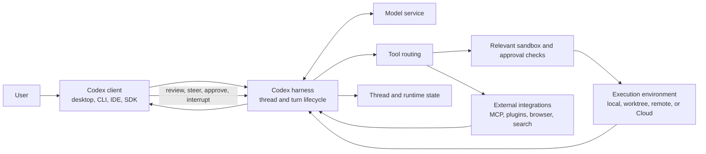

# Codex capability and operating-model catalog

**Research cut-off:** October 22, 2026  
**Purpose:** map what Codex can do, how its public agent harness and clients operate, and which capabilities merit later study for an auditor-focused product adaptable across practice areas and industries. This is a research inventory, not an implementation plan.  
**Evidence:** current public OpenAI documentation and the public `openai/codex` repository. Codex features vary by client, operating system, plan, account, workspace policy, enabled tools, and rollout. No signed-in Codex session was operated for this catalog.

## How to read this catalog

The Codex and ChatGPT Work inventories are two distinct evidence streams. Work documentation describes its user-facing task workflows. Codex documentation and source describe Codex-specific products and the open agent harness used by Codex clients. OpenAI says some execution, isolation, and permission mechanisms are shared in documented Enterprise/Edu Work environments, but that bounded statement does not make the public Codex repository a source tree for ChatGPT Work.

The user's product hypothesis is to study both layers together: Work contributes task-shaped workflows and reviewable outcomes; Codex contributes a powerful agent runtime, tools, state, and operating controls; an auditor-focused product could adapt or extend ideas from both across practice areas, industries, and methodologies. The user has specified two possible modes: work with a practitioner's external system of record, or include a built-in Diligent-like audit record system. This hypothesis is the lens for scouting, not a conclusion about implementation or architecture.

“How it works” below reports documented Codex behavior. Audit relevance is a research interpretation. It does not mean Codex is an audit system or that a feature has already been selected for a future product.

## Product surfaces and run locations

| Surface or mode | How it works | Auditor-product research lens and limits |
| --- | --- | --- |
| **Codex in the ChatGPT desktop app** | A project-oriented Codex surface in the ChatGPT desktop client. It brings together projects, threads, agent activity, files, an integrated terminal, Git/review views, settings, skills/plugins, scheduled tasks, and local/cloud execution choices. The app is available on macOS and Windows, with a Linux preview; feature availability differs by platform (for example, Computer Use is not in the Linux preview, and native Wayland support is experimental). | Study how a user moves from an engagement/project to a task, sees agent activity, and reviews results. UI organization alone does not provide engagement records or sign-off controls. |
| **Projects, chats, and navigation** | Codex projects organize related local folders, instructions, and chats; a Codex chat can also start without a project for self-contained work. Projects can contain parallel chats for distinct outcomes. The desktop app provides task/project navigation and search, while the CLI treats its current directory as the project and the IDE extension uses the open workspace. Project context and automatic instruction discovery differ by client and by primary/secondary folder. | This is the product's main context and continuity model. Map what is shared across chats, what each task can read, how users resume/search/archive/pin work, and which project folder sets the execution boundary. |
| **Codex CLI** | An interactive terminal client for exploring a repository, planning, editing files, running local development tools, reviewing changes, connecting tools, resuming chats, and handing work to cloud environments. `codex exec` runs non-interactive jobs in scripts or CI and can stream structured JSONL events. | Provides an inspectable, tool-rich work loop. The CLI is developer-oriented; commands, raw diffs, and repository assumptions may not fit an auditor's task language. |
| **CLI command and session controls** | The command surface includes interactive and non-interactive task start, resume/fork/export, login/logout, model/config selection, project navigation, permissions/sandbox controls, review, cloud/remote handoff, app/MCP/plugin management, and automation. The CLI cloud and cloud-tasks commands are documented as Experimental, while codex agents is Stable. CLI customization also covers the terminal interface, editor, completions, and keyboard shortcuts. Slash commands control an active session, including plan, goal, model, permissions, agents, subagents, apps, plugins, hooks, review, status, context compaction, configuration search (`/config`), keymap customization (`/keymap`), and server restart/reconnect (`/daemon`). `codex remote-control` is an Experimental CLI command; it is distinct from the separately documented Codex Remote mobile workflow. References mark command maturity; experimental and deprecated entries are not equivalent to stable defaults. | Treat commands as part of the product's interaction design and control plane, not just terminal syntax. For each workflow record the entry point, state change, confirmation, permissions, and output/event behavior. |
| **Agent Command Center (`codex agents`)** | The Stable CLI command `codex agents` opens a command center for chats on a shared local or remote server; it shows task status and lets users switch between chats/agents. `/agents` opens the same center in an interactive session. Remote use can target an app-server endpoint. This is a navigation/coordination surface, not the act of spawning a subagent. | Study its server boundary, which workstreams are visible, status/attention states, and how a user resumes or switches work. Keep it distinct from delegated agent orchestration and from ChatGPT Work task navigation. |
| **IDE extension** | Brings Codex into a supported code editor with project context, agent conversations, tools, and code review. Specific plugin, UI, and orchestration features differ from desktop and CLI. | A useful comparison surface for inline evidence and action review; it is not a general audit workspace. |
| **Codex Cloud** | Runs a task in a remote workspace prepared from selected repositories, dependencies, tools, and allowed services. Each task has its own working files; it can continue while the user's computer sleeps. Results can be inspected, followed up, committed, or turned into a pull request. | Cloud work can be isolated and persistent without a local workstation. It cannot automatically see local files, running processes, browser sign-ins, VPN access, or local-only policy. |
| **Mobile and remote control** | Supported mobile clients can start, steer, approve, and review Codex work running on a connected computer or in Cloud. Remote access uses the host's project, files, tools, permissions, and credentials; the phone is a control/review surface, not the local execution environment. The mobile Codex Remote experience reached general availability for connected Mac/Windows hosts in the June 25, 2026 release. This is distinct from the CLI `codex remote-control` command, which remains Experimental. Supported remote-host and SSH workflows can also move threads and Git state between hosts. | Shows how work can remain steerable away from the workstation. Verify who is connected, which host executes, and which host's permissions apply. Availability still varies by platform, plan, and workspace policy. |
| **Codex Micro hardware controls** | Codex Micro is a limited-run physical input device for the ChatGPT desktop app. Its Agent Keys can follow chats and reflect status; Command Keys, a stick, and a dial can trigger chat actions, approvals, skills, voice input, navigation, and other desktop commands. Supported hardware, OS input permissions, and the companion app affect availability. | A hardware surface can make task switching/status/steering more immediate. It is an optional peripheral, not a capability of the agent runtime itself; study its device permissions, accessibility value, and hardware dependency separately. |
| **Local, worktree, and cloud environments** | A thread can work directly in a local checkout, in an isolated Git worktree, or in a published Cloud environment. Worktrees separate concurrent Git tasks; cloud environments package reusable repositories, tools, and setup. Handoff can move a supported thread between local and worktree execution. | The execution location changes available data and isolation boundaries. A worktree isolates Git changes but is not a separate identity or audit engagement by itself. |

## Public implementation map

This map uses the open-source repository to explain Codex's published components. It is not a claim that the whole Codex desktop app, ChatGPT Work, model service, cloud control plane, or all connected integrations are open source.

| Component | Public role indicated by the repository/docs | What remains outside this evidence |
| --- | --- | --- |
| `codex-rs/core/` | Reusable agent/runtime logic used by Codex user interfaces: turn execution, context and tool orchestration, configuration, permissions, and sandbox integration. | A crate README and source tree do not establish all hosted product behavior or client UX. |
| `codex-rs/app-server/` and `codex-rs/app-server-protocol/` | Local client/server integration layer and versioned protocol for authentication/account state, threads, turns, streaming events, files, tools, settings, and approval requests. | Experimental APIs and methods may change. The desktop product UI and some remote/hosted services are separate. |
| `codex-rs/exec-server/` and sandboxing modules | Process/PTY execution, streamed command output, and platform-specific enforcement of filesystem/network boundaries. | Available OS controls differ. A command/tool's effective authority also depends on which execution path a client exposes. |
| `codex-rs/memories/`, `codex-rs/thread-store/`, `codex-rs/state/`, and `codex-rs/rollout-trace/` | Published components for local memory, thread history, runtime state/persistence, and opt-in diagnostic traces that relate model-visible items to tool calls, terminal operations, nested Code Mode calls, compaction, and child threads. | Cloud task history, account/workspace storage policies, complete product retention behavior, and an immutable audit log are not established by these components. Diagnostic bundles may contain sensitive prompts and tool data. |
| `codex-cli/`, `codex-rs/tui/`, and `sdk/` | CLI client/TUI entry points and programmatic SDK integration for local Codex workflows. | The SDK/app-server are distinct integration choices with different supported use cases and stability. |
| `docs/`, `codex-rs/protocol/`, and `codex-rs/app-server-protocol/` | User docs, internal/runtime protocol types, and client-facing event/request schemas that help reconstruct behavior and message flow. | Current `main` can include experimental features and does not prove a specific released client has them enabled. |

At a high level, the documented flow is: a client opens a thread and supplies a user turn plus environment and policy context; the harness builds model context, requests model output, routes tool calls through the appropriate execution or integration path, enforces applicable permissions/approvals, streams events back to the client, and persists thread state for supported resumable workflows. Compaction, goals, and memory address different time horizons: the active context window, a durable objective within a thread, and reusable local recall across eligible sessions. These are conceptual summaries of the public docs and code, not a complete formal architecture specification.

The diagram is a conceptual reading of public Codex sources, not a fixed design recommendation. Not every integration follows the same execution or approval path, and the desktop product UI and hosted services are not all represented in the repository.

## Agent runtime and work lifecycle

| Capability | How it works in Codex | Auditor-product research lens and limits |
| --- | --- | --- |
| **Agent harness / tool loop** | The open Codex harness manages conversation state, streams model and tool activity, calls tools, applies sandbox and approval policy, and carries a task across turns. A model proposes or selects work; tools perform allowed operations; the client presents progress and decisions. Model access and some managed services are separate from the open-source harness. | This is the runtime foundation relevant to your comparison with Work. Capture the boundary between model reasoning, orchestration, tool execution, application UI, and external services rather than attributing every product capability to one component. |
| **Parallel independent read-only lookups** | Recent CLI release notes document parallel execution of independent read-only lookups, including skill, memory, and conversation-history reads. This is a narrow optimization for independent reads; it does not establish general parallel writes or replace the separate subagent workflow. | Parallel reads can reduce wait time while keeping the main agent in control. Study the declared independence conditions, ordering, cancellation, and how partial failures are represented; do not infer concurrent mutation safety. |
| **Threads and turns** | App-server exposes thread start/resume/fork/read/list/archive/delete operations and turns that accept input, execute, stream events, and complete, fail, or be interrupted. A thread can be resumed and continued; forks provide an alternate history branch. | Thread history can help preserve investigative context. A chat transcript does not automatically meet evidence-record, retention, or supervisory-review requirements. |
| **Progress, steering, and interruption** | Clients stream agent messages, tool calls, command output, file changes, questions, approvals, and status. Users can send follow-up instructions, steer or queue work in supported clients, answer questions, or interrupt a turn. Behavior and controls vary across clients. | Useful for a human-in-the-loop investigation. Need to distinguish a model's progress statement from verified work performed and preserve the user's review/decision points. |
| **Plan mode and task lists** | Supported clients can ask Codex to plan before making changes, show questions or a task checklist, and let the user refine the approach. Plan-mode availability and exact interaction differ by client and version; a displayed plan is model-generated working guidance, not an approved engagement program or instruction. | Could make an investigative approach reviewable before execution. For IIA internal audits, it would not substitute for the CAE-approved work program; other practices have their own approval roles and requirements. |
| **Goals and long-running tasks** | A Codex goal can persist an objective, completion criteria, and steering context across repeated work until a stopping condition; users can inspect, edit, pause, resume, or clear it. A goal is thread state, not global memory or project instructions. | Could represent a bounded recurring analysis objective in later exploration. It is not equivalent to an approved audit engagement or authorization to expand scope. |
| **Background tasks and parallel work** | Supported clients can keep long tasks, terminals, delegated agents, or scheduled work running while the user follows progress or does other work. Some status/task views let users inspect active or completed work and attend to items needing input. | Background completion should lead to a human review gate. Determine what is retained, what can still run, and how failures or missed triggers are surfaced. |

## Inputs, reasoning, execution, and outputs

| Capability | How it works in Codex | Auditor-product research lens and limits |
| --- | --- | --- |
| **Repository and file understanding** | Codex can inspect the working directory, search/read relevant files, follow repository instructions, explain unfamiliar code, and use attached/path-selected context. The exact read scope depends on the environment and sandbox. | This suggests source-bounded investigation patterns, but Codex's repo-indexing assumptions are code-specific. For audits, sources need stable IDs, provenance, scope, and evidence completeness checks. |
| **Code and shell execution** | Codex can propose or run shell commands, local programs, and project tools; it can inspect output and use it in subsequent reasoning. In the CLI, the environment determines what analysis libraries and programs are present. File writes and commands are subject to sandbox and approval policy. | Shell/Python use may support custom data analysis when tools are installed, but the public sources do not establish a dedicated general-purpose spreadsheet/data-analysis engine in Codex CLI. Treat an analysis result as method-dependent and inspectable, not automatically validated. |
| **Code Mode** | Public configuration documentation describes Code Mode as under development and off by default. Where enabled, it lets a model-authored JavaScript cell call tools through an execution host; where enabled, turn interruption is intended to stop active cells and nested tool calls, but this is feature-dependent and not an unconditional reliability guarantee; [public issue #51696](https://github.com/openai/codex/issues/51696) reports a Windows case where an interrupted cell leaves the turn hung. The public repository also has a separate [CodeModeInterrupt feature flag](https://github.com/openai/codex/blob/main/codex-rs/features/src/lib.rs). Availability depends on client/configuration; preserve the documented maturity label rather than treating it as a generally available capability. | Include emerging runtimes in the capability map, but keep their maturity and effective permissions visible. An execution-host interface does not by itself define a safe or auditable boundary. |
| **File creation and editing** | Codex can create or modify workspace files and present diffs. Users can inspect, stage, unstage, revert, commit, or push changes in supported clients. CLI output is generally a developer file/diff workflow; it lacks Work's side-by-side artifact annotation experience. | In external-record mode, generated reports, analysis, scripts, or workpapers should be transferable to the practitioner's chosen systems. In built-in-record mode, questions include how drafts, evidence links, authorship, review status, and authoritative records relate. |
| **Images and visual inputs** | Supported Codex clients can accept image inputs such as screenshots or diagrams. Remote and mobile clients add attachment flows, with supported types varying by host/client/version. | A screenshot can supply context but may not be a complete or authentic system record. Capture source, timestamp, scope, and limitations separately. |
| **Image generation and editing** | Supported Codex desktop, CLI, and IDE flows can generate or edit images, including through the reusable image-generation skill. Outputs can be UI assets, illustrations, or other visual files used alongside code. Usage, quality options, and availability depend on the surface and workspace. | This expands Codex outputs beyond text and code. Preserve source inputs and label illustrative generated images separately from evidence or validated diagrams. |
| **Composer Predictions** | In the desktop composer, an eligible user can receive a suggested continuation while drafting; Tab accepts it as a draft in the composer rather than sending the message. The changelog describes the feature as beta with account, plan, age, and region eligibility limits. | This is an input-efficiency aid, separate from autonomous agent action. Study whether suggestions can be distinguished from user-authored text and how accidental acceptance/send is prevented. |
| **Web search, built-in browser, browser extension, and Computer Use** | CLI/IDE web search can use cached or live results according to settings; it is distinct from the local shell network proxy. The desktop built-in browser has a separate browser profile and is suited to public sites or local web apps. A supported browser extension can use existing tabs and signed-in browser context after its permissions and website access are approved. Desktop Computer Use operates supported macOS/Windows GUI apps with OS permissions and action approvals. It can expose screen content, screenshots, clipboard, and app content; per-app access and allow-list policy apply. Windows use remains in the foreground with the target visible. macOS locked use is a separate, opt-in, short-lived path scoped to trusted active turns and re-locks on local input. These are distinct paths with different browser state and policy boundaries; browser/Computer Use do not inherit shell network rules. Page content remains untrusted, and some UI actions, such as built-in-browser file upload, are unsupported. | Useful for public criteria or observing application workflows. Treat page content and visual output as untrusted/contextual evidence; retain source, access date, and scope. GUI actions can expose signed-in sessions or affect external systems, so distinguish inspection from consequential change and record which browser path supplied context. |
| **Browser annotations and site integration API** | In the desktop app built-in browser, a user can select page content, add a comment, and send selected content plus available context into Codex. The Browser Annotation API lets a website customize selectable targets, metadata, and preview controls; some controls are available only in Codex or on localhost. In the reviewed docs, WebMCP is separate: Work/Codex may use regular browser interactions without those being WebMCP tool calls. | This gives the user a structured way to point Codex at a passage, object, or UI state. Study what page metadata accompanies the selection, whether it is user-visible, and how it differs from evidence capture or an app connector action. |
| **Appshots** | In the ChatGPT desktop app on macOS and Windows, an Appshot attaches an image of the frontmost window plus text the app makes available, which can include accessible text outside the visible scroll area. Some apps expose only the screenshot/visible content. It requires relevant OS permissions and becomes an attachment in the chat/session. | A fast way to provide context from another application, but it is a point-in-time capture with app-dependent text coverage, not a complete system record or evidence acquisition protocol. |
| **Analysis and code review** | Codex can reason over repository state and tool output, run project-specific analysis commands, and perform a dedicated `/review` of a diff, commit, or branch. Review reports prioritized findings without changing the working tree. Desktop review surfaces support Git review and inline feedback. The separate Codex Security capability has local plugin/workbench, Cloud, CLI, and SDK entry points; it produces code-vulnerability findings with evidence and supports validation/remediation workflows. Security Cloud is a research preview for connected GitHub repository scans and monitoring new commits. Security Review can post findings meeting configured thresholds to GitHub PRs while keeping its full report in Codex. Access and maturity differ by entry point. | The review workflow is a strong example of separating analysis from mutation. A software finding review or vulnerability scan is not the same as an auditor’s evaluation or a conclusion approved under a specific practice methodology. |
| **Codex Security scans and workbench** | Codex Security is a distinct security product family: a local plugin/workbench for interactive repository scans and findings; a Cloud plugin for connected GitHub repositories and commit monitoring; and CLI/SDK paths for repeatable or automated scans. It supports deep and bulk scans, change reviews, triage of existing findings, patch generation and verification, hardening proposals, vulnerability reports, export/tracking, and GitHub/GitLab CI flows. Cloud is documented as research preview; access, runtime, and maturity differ by entry point. This is separate from the sandbox and permissions that secure Codex itself. | Study scan scope, coverage, finding evidence, history, triage, fix verification, and exports. This security product is not an audit methodology or general-purpose audit assurance layer. |
| **Desktop editor and PR Chat** | The ChatGPT desktop app lets users edit Markdown and code, annotate selected content to request revisions, and review GitHub PRs in contextual PR Chat. Supported flows include inline review feedback and inspecting, editing, accepting, or rejecting proposed patches. These are desktop product interactions layered on the Codex work loop. | Study the distinction between in-place artifact editing, conversational requests, review comments, and accepted changes. A patch acceptance is not equivalent to audit-workpaper approval. |
| **Generated outputs and previews** | Codex returns text and file changes, with file previews for supported documents, presentations, spreadsheets, PDFs, and HTML where available; supported previews can accept annotations. CLI has no equivalent visual preview/annotation surface, and IDE workflows depend on a compatible external viewer. Code review is especially Git-diff-centered. CLI clients expose results in the terminal. | Study which outputs can be reopened/reviewed and which are only transient conversation content. Do not assume Codex artifact handling equals Work's document/spreadsheet authoring workflow. |
| **Sites and hosted app outputs** | As of this catalog's cut-off, Sites is a public-beta, ChatGPT-managed capability in supported web or desktop flows. Codex can help create/refine websites, dashboards, web apps, games, or compatible existing projects, then save, deploy, and manage them through the Sites experience. CLI/IDE can edit and test local source but do not provide the same Sites project management workflow. Deployment URLs are production deployments, so a saved non-deployed version is available for review first. | This is a productized build-and-publish workflow with hosting and optional data storage, not just code generation. Study versioning, identity/access controls, deployment visibility, hosting boundary, and how generated app data is handled. |

## Tools, integrations, and extension mechanisms

| Capability | How it works in Codex | Auditor-product research lens and limits |
| --- | --- | --- |
| **Built-in tools** | The runtime provides tools for workspace files, shell/process execution, images, web search, and related agent operations depending on surface and environment. A tool's availability is not the same as permission to use it; sandbox and approval checks apply. | Make capability, authorization, and actual invocation separately observable. |
| **Connected apps and app catalog** | App integrations are a separate capability family from arbitrary MCP servers. App-server exposes app catalog and installation/effective-state information; clients can distinguish an app that is accessible from one that is enabled and one that is currently callable under configuration, tool policy, and identity. CLI exposes an `/apps` picker where supported. App/connector traffic is outside the sandboxed-command network proxy and its domain allowlist, so it has a separate network-control path. | Inventory the app, its effective enabled/callable state, identity, scopes, network path, and available operations separately from MCP server configuration. A visible app entry does not prove a particular tool call is available or authorized. |
| **MCP servers and connected tools** | Codex can connect to local or remote Model Context Protocol servers. Servers can expose tools, readable resources, and reusable prompts; the user can inspect available servers/tools and authenticate. Tools may be read-only or cause external side effects. Codex can connect to external MCP servers; its former standalone codex mcp-server host was removed. The app-server uses a separate JSON-RPC protocol and is not a drop-in MCP replacement. | An auditor-specific tool connection needs least-privilege scopes, identity transparency, freshness indicators, and a distinction between reading evidence and changing a source system. |
| **Plugins and marketplaces** | Plugins package reusable capabilities and can include skills, MCP servers, optional UI, browser extensions, or hooks. Plugins may be installed from curated or project/team marketplaces. Installing a plugin and authorizing each embedded capability are separate concerns. Workspace skills, local filesystem skills, and plugin-packaged skills have distinct ownership and lifecycle controls; plugin support and management differ by client, including the IDE extension. | A plugin can package approved audit procedures and authorized data connectors. Review every included script, tool, identity, and permission; a marketplace listing is not assurance of audit-methodology approval. |
| **Skills** | A skill is a reusable workflow bundle: instructions plus optional reference material, scripts, and resources. Codex can select a skill from its description or a user can invoke it explicitly. Skills guide behavior; they do not themselves grant access to records or apps. Workspace skills, local filesystem skills, and plugin-packaged skills have different owners, distribution paths, and administrator controls. | Could encode a controlled test method or report convention. Research ownership, versioning, approval, and evidence of which skill version was used. |
| **Record & Replay** | On supported macOS desktop setups with Computer Use enabled, a user can demonstrate a workflow after granting recording permission. Codex observes actions and window content until recording is stopped, then drafts a reusable skill with inputs, steps, and verification guidance. The skill can later use tools available in that task, including Computer Use, browser actions, and plugins. The guidance recommends avoiding secrets and sensitive data. | This could turn a demonstrated repetitive workflow into a draft procedure. The steps need review and validation across cases; recording does not establish that a procedure is appropriate or prove a later replay was performed correctly. |
| **Repository instructions and configuration** | `AGENTS.md` gives durable repository/project guidance; Codex discovers applicable instruction files across relevant directories. `config.toml` and managed requirements configure models, tools, approvals, sandboxing, and other behavior with layered precedence. Some config can exist outside the project. | This is powerful operational context. For a folder-scoped auditor product, explicitly study precedence and prevent unintended user-wide or machine-wide context from silently shaping engagement work. |
| **Hooks** | Lifecycle hooks can invoke scripts or already-connected MCP tools at events such as prompt submission, tool use, compaction, subagent stop, or turn/session end. Hooks can add context or enforce a supported policy; command hooks run in the execution environment. Non-managed hooks require review/trust, and hook capabilities vary by execution mode. | Hooks can apply validation, logging, or policy checks, but failure semantics and coverage matter. A hook is not automatically a complete immutable audit log; verify which events it sees and what happens on error/timeout. |
| **App-server protocol** | The open-source app-server lets a rich client communicate with a local Codex process over JSON-RPC using stdio by default, with Unix socket and experimental WebSocket transports under documented limitations. It exposes account/auth, thread/turn operations, streamed events, models/config, tools, app catalog state, and approvals. The former codex mcp-server was removed; the app-server is a different JSON-RPC protocol, not an MCP server. Its dynamicTools/item-tool-call extension is experimental and requires opt-in. Execution APIs have different authority: `thread/shellCommand` is explicitly user-initiated and outside the thread sandbox with full access; `command/exec` runs under the server sandbox; experimental `process/spawn` can run outside the sandbox and requires opting into the experimental API. The `codex app-server` command is Experimental; docs say the command and WebSocket transport are not supported for production. | This is the clearest public integration surface for studying how a host UI can own workflow while Codex supplies a runtime. Execution paths demonstrate why an integrator must map authority per operation and avoid treating the app-server as one uniform sandbox. Experimental API status and limitations need checking before any later decision; this is not evidence Work uses this design. |
| **Client-supplied dynamic tools (app-server)** | The app-server supports clients supplying dynamic tool definitions and handling model requests through an item/tool/call cycle. The API is experimental, requires experimental API opt-in, and is distinct from connecting an external MCP server. | This lets an integrating product provide task-specific tools at runtime. Study schema trust, identity, approvals, cancellation, result validation, and how the host sees each call. |
| **Codex SDK, non-interactive execution, and GitHub Action** | The TypeScript SDK wraps/spawns the CLI and exchanges JSONL for local thread run/stream/resume; the Python SDK controls local app-server over JSON-RPC and is documented as stable. The Python SDK is documented as a stable package, while the `codex app-server` command is Experimental and the WebSocket transport is not supported for production; these are separate maturity labels. `codex exec` runs scripted/CI tasks and can emit JSONL lifecycle/tool events or avoid persisting rollout files when ephemeral. OpenAI documents a GitHub Action for repository automation. | Separate attended engagement tasks from unattended batch jobs. Any later audit use would need explicit scope, identity, approval, logging, and stop conditions. |
| **Task entry points from connected services** | Depending on plan and configuration, Codex can participate in GitHub review flows and selected integrations such as GitHub, GitLab, Slack, or Linear. GitLab Cloud support is beta as of this catalog's research cut-off. Enterprise Cloud delegation can also let users route tasks from Slack or Microsoft Teams into configured Cloud environments. These entry points create or route work from another service; they are separate from the local CLI/app-server tool loop and may use hosted execution. | Determine whether an item is a task request, source evidence, comment, or approval, and which identity and record system owns it. Connector availability and automation behavior are workspace-specific. |

## Delegation and collaboration

| Capability | How it works in Codex | Auditor-product research lens and limits |
| --- | --- | --- |
| **Subagents** | A main agent can delegate independent questions to specialized agents, each with its own task context; the main agent coordinates and combines returned findings. Local Codex can be instructed directly or by applicable `AGENTS.md`/skill guidance. Custom definitions can set role instructions and supported model/reasoning options. Users can inspect agent activity/threads in supported clients. | Parallel research can cover criteria, population analysis, or evidence groups. Preserve who/what produced each result, source range, independence, and reviewer verification. Parallel output is not corroboration unless the methods and evidence are independent. |
| **Side chats, fork, and task references** | A side chat or fork starts a separate conversation path so a focused question or alternate approach can be explored without rewriting the parent transcript. Some clients can reference other tasks and navigate between parent/child work. | Supports focused consultation and rework. Research how conclusions flow back and how superseded branches are marked so an auditor does not cite a stale path. |
| **Worktrees and concurrent tasks** | Git worktrees give independent Codex chats separate working directories for the same repository; app-managed worktrees can be disposable or permanent. Local, remote, scheduled, and cloud task behavior differs. | This is a concurrency/isolation pattern for code. Filesystem isolation does not replace the practitioner's chosen engagement, evidence, approval, or transaction systems. |

## Context, memory, and continuity

| Capability | How it works in Codex | Auditor-product research lens and limits |
| --- | --- | --- |
| **Active context and compaction** | Codex carries relevant thread instructions, user turns, tool results, and working state in the active context. When context grows, automatic or requested compaction replaces earlier history with a condensed continuation state; clients can expose compaction/activity events. Compaction reduces context pressure but is not a promise that every detail remains. | Important scope, criteria, evidence IDs, and approvals should be persisted in explicit records, not left dependent on a compressed conversational context. Examine recovery and traceability behavior. |
| **Conversation persistence and history** | Codex clients can resume, list, search, fork, archive, or delete local/cloud/remote threads depending on surface. App-server history is structured in thread/turn/item events; local rollout storage and Cloud storage differ. | A persistent thread is useful working context, but it is not necessarily the authoritative audit file, final workpaper, or immutable log. |
| **Memory** | Local Codex memory can retrieve reusable details from prior work when enabled; current docs describe it as a separate, controllable local store, disabled by default in the documented configuration. It is distinct from ChatGPT account/workspace memory. | Do not rely on recalled memory for audit criteria, transaction facts, or approvals. Study inspectability, deletion, scope, and how task-specific data is kept out of reusable memory. |
| **Computer History** | An optional macOS desktop capability turns interaction events and accessibility text from user-allowed apps/sites into a searchable timeline and local Markdown memories that ChatGPT and Codex can reference. It requires Memories; workspace access and individual opt-in are separate in managed workspaces. Temporary event files are kept locally for up to 48 hours. An ephemeral Codex session processes the event stream on OpenAI servers to create summaries; generated Markdown memories remain local and are not encrypted by this feature. It does not include screenshots or private-mode browsing. | This is a distinct, ambient context source, not ordinary conversation memory. Study consent, per-app/site scope, pause/delete controls, local storage, processing path, and whether its event-derived summaries are suitable for any specific work. |
| **Durable instructions vs memory vs skills** | `AGENTS.md` sets project/repository guidance; skills package repeatable task procedures; memory recalls selected prior context; conversation history stores the current/previous interaction. They have different scope, lifecycle, precedence, and visibility. | This separation is central to the user's two-layer study. Audit methodology, engagement-specific facts, and personal preferences should not be conflated; later planning must define authority and retention for each. |
| **Usage, models, speed, and reasoning controls** | Users can select available models/reasoning effort and inspect usage, token activity, or limits in supported clients. Fast mode speeds supported models with higher usage; Ultrafast supports selected models on eligible plans and has higher usage multipliers. Fast is documented for desktop, CLI, and IDE with ChatGPT sign-in; Ultrafast availability and workspace enablement depend on model, plan, residency, and billing arrangement. Subagents and tool work also consume resources. | For later review, determine which model, speed, effort, skill, and agent configuration shaped an output, and how cost/usage is attributed. A selected model or faster setting is not a substitute for human validation. |
| **Amazon Bedrock provider** | Supported local desktop, CLI, IDE, and SDK workflows can send model requests directly to Amazon Bedrock using AWS-native authentication and access controls. In that request path, the OpenAI-hosted Responses API is not involved. Cloud-hosted Codex tasks and features requiring OpenAI-hosted services are not supported through this direct provider path; supported models and features vary by AWS Region and endpoint. | This changes the model provider, identity, and data path while leaving the local Codex harness in use. Capture which client, endpoint, model, AWS identity, region, and unavailable hosted features apply. |
| **Organization model gateway** | Codex can route model-provider requests through an organization-configured LLM gateway using a gateway URL, provider ID, model alias, credential or token resolver, and optional model catalog. The gateway must support the documented Responses API streaming/tool behavior. A separate ChatGPT-sign-in-through-gateway path is documented. This governs model requests only: MCP, plugins, apps, and other tools can use separate network and identity paths. | A gateway can centralize model routing, credentials, and some observability without making the entire agent task or every connected tool pass through that gateway. Map model traffic separately from evidence-source access and tool execution. |
| **Local open-source model provider (`--oss`)** | The CLI can use a local Ollama or LM Studio provider with `--oss`; `--local-provider` selects one for a run, while `oss_provider` sets the default. Interactive CLI can prompt if none is selected; non-interactive `codex exec` errors when no local provider is configured. This is a CLI model path and does not establish that integrations or every tool work offline. | Local model execution changes the inference path but not necessarily the data path of connected apps or tools. Keep provider identity, local service, model capability, and online integrations distinct. |
| **Programmatic access and service identities** | In supported Enterprise/Business configurations, Codex access tokens can authenticate trusted non-interactive local CLI or app-server workflows as the workspace user who created the token; service-account flows are separately documented. These are credentials for automation, not ordinary interactive sign-in or general API keys. | Record the effective principal and credential type for unattended runs. Token support and scopes are plan/admin dependent; public CI, shared runners, or reused human tokens change the exposure and attribution model. |

## Workflow, review, and operational controls

| Capability | How it works in Codex | Auditor-product research lens and limits |
| --- | --- | --- |
| **Git and change review** | Desktop Codex can show unstaged/staged/commit/branch/last-turn diffs, annotate lines, stage/unstage/revert chunks or files, commit, push, and create pull requests in supported setups. `/review` can analyze a selected diff without changing the working tree. | This provides granular review and acceptance steps for code. Map analogous audit review concepts only after separating software changes from audit evidence and workpaper approval. |
| **Scheduled tasks** | The desktop app can schedule tasks against local projects or isolated worktrees; tasks can recur and use skills/plugins. Local schedules require the computer/app to be available; CLI and IDE do not provide the same management UI. Scheduled tasks may be configured to return to an existing chat or start separately, and run unattended under configured/default sandbox and approval settings. Event-triggered Work tasks (Gmail, Slack, GitHub) are a separate workflow documented in the Work catalog, not the Codex desktop local-project schedule path. | Could support repeat monitoring or recurring evidence checks, but scheduling does not assure successful execution or authorize closure of an audit action. Review every run and its access scope. |
| **Voice and dictation** | Supported desktop/mobile clients offer voice input or voice task interaction to start, steer, or review work; model and platform support vary. Desktop voice can continue with an existing task's context/model. Screen context is documented for macOS and may include accessible text outside the current viewport; CLI `/voice` is a separate experimental path. No general audio/video-file input claim is established for CLI in this pass. | Useful for hands-free steering or notes, but does not establish an audit interview record, consent, transcription completeness, or evidence retention. |
| **Notifications and task visibility** | Desktop/mobile surfaces show active, unread, blocked, or waiting work and can notify the user when attention is needed. Exact states, filters, and alerts vary by client. | A status indicator should lead to examination of the underlying run and output, not serve as a sign-off. |
| **Pets and floating task companion** | In the ChatGPT desktop app, an optional animated pet can float above other windows, open a chat by text or voice, and show task activity. The selected pet changes appearance rather than agent behavior. Custom pets are available through the app; Codex CLI can use a user's own pet. | This is a peripheral status and entry surface rather than an agent capability. Evaluate whether ambient cues help practitioners, while keeping status indicators distinct from authoritative completion or approval records. |
| **Import and setup migration** | The desktop app can import supported setup/recent work from Claude Code, Claude Cowork, or Cursor. Codex CLI imports from Claude Code or Cursor using local `/import`; it can include up to 50 chats from the last 30 days and is unavailable during a running task, remote session, or local app-server daemon. Supported imports can include instruction files, settings, skills, plugins, project folders, memories, MCP configuration, hooks, slash commands, subagents, and recent chats. Imported plugins/connections may still need authorization. | Useful for studying portability, but importing an instruction or hook can change behavior. Maintain provenance and review configuration before relying on it. |
| **Shared thread snapshots** | The ChatGPT desktop app on macOS can publish a read-only point-in-time snapshot of a local Codex thread. Personal-account links can be opened by anyone with the link; workspace links can be restricted to the originating workspace and invited people/groups. A snapshot includes supported visible thread content and diffs, not original tool calls or their inputs/outputs; known secret patterns are redacted, but other sensitive content can remain. Links can be reviewed or revoked. | Sharing a result is separate from granting access to its project or execution environment. Examine audience, snapshot contents, redaction limits, and revocation when mapping collaboration and review. |

## Security, privacy, and trust boundaries

| Control area | How it works in Codex | Auditor-product research lens and limits |
| --- | --- | --- |
| **Sandbox and permission profiles** | Codex distinguishes filesystem write scope from network access; the sandbox governs what a command can technically access. Local OS enforcement differs by macOS, Linux/WSL, and Windows. Local, worktree, remote host, and Cloud environments have separate available resources. New named permission profiles for local commands are documented as beta and actively changing; they define filesystem/network access and differ from legacy `sandbox_mode` settings. Cloud setup and agent phases also have separate access. | Model technical reach separately from identity and approval. A workspace sandbox is a technical boundary, not an engagement authorization decision. |
| **Approvals and automatic review** | Sandbox and approval policy are separate. Routine operations allowed inside the active sandbox can proceed without a separate prompt; approval is generally relevant when an action would cross the boundary or configured policy requires confirmation. Auto-review routes eligible interactive approval requests to a separate reviewer; it does not grant permissions or expand access, requires an interactive approval mode, and can make mistakes. Computer Use prompts still go to the user. Full access combines `danger-full-access` and `approval_policy=never`, removing sandbox boundaries and approval prompts. | Study what is permitted, what triggers a prompt, who can approve/review, and what evidence the client records. Never assume every action has a separate prompt or that user/agent approval validates the result. |
| **Approved cyber model access (Daybreak / Trusted Access)** | Daybreak Blue is an approved defensive-cyber model offering; Daybreak Red is a specialist cyber offering for explicitly authorized advanced work and requires separate approval/provisioning. Access is conditional on the approved identity or service, workspace/API organization and project, model/offering, and product surface. Approval for Blue does not grant Red, and Trusted Access does not itself grant Zero Data Retention. This model-access program is separate from the Codex Security scanner. | This is a specialized access/safeguard path rather than a general Codex capability or audit methodology. For IT/IS audit research, record the authorization boundary, eligible model, client, project, environment, and oversight requirements; never infer that approval authorizes activity outside its stated scope. |
| **Prisma AIRS prompt inspection** | In supported ChatGPT-workspace-authenticated Codex app, CLI, IDE, and Cloud workflows, an administrator can route newly submitted prompt text to configured Prisma AIRS for DLP, prompt-injection, or malicious-URL checks. Policy can block or alert and can be configured fail-open or fail-closed. This does not scan model responses, tool calls/results, files, or images; API-key-authenticated sessions are excluded. Availability is organization-configured and request/enablement-dependent. | This is an external prompt guardrail with a narrow inspection boundary. Study exactly which inputs are inspected, which identities and surfaces are in scope, and how block/alert outcomes are exposed and recorded. |
| **Command rules** | Separate command-prefix rules can allow a command outside the sandbox without prompting, require a prompt on each matching invocation, or forbid it. Rules are documented as experimental; when multiple rules match, the most restrictive decision wins. Rules are not a general control over apps, MCP, browser, Computer Use, or Cloud tools. | Treat command rules as another authorization layer, distinct from sandbox reach, approval policy, and connector permissions. Record rule source, matching logic, precedence, and shell parsing limits. |
| **Agent Security and managed policy** | Enterprise Agent Security separates Global orchestrator controls (such as approvals and web-search modes) from execution settings, with supported Local and Codex Cloud overrides and inheritance rules. Managed requirements can govern permission profiles, sandboxing, networking, apps/MCP/plugins, rules, and hooks. ChatGPT Work Cloud has separate capability permissions and does not inherit Codex Cloud Agent Security requirements. | This is an administrator policy plane above personal configuration. Study effective settings, precedence, environment scope, and how the product explains inherited or managed restrictions. |
| **Workspace roles, access, and user lifecycle** | Enterprise/business administration separates workspace seat and role from local runtime access, Codex Cloud, Platform API, plugin access, and source-system permissions. SCIM/groups can provision access; lifecycle workflows include moves and deprovisioning. Codex tokens require separate review/revocation: disabling local access can suspend tokens without revoking them, so restoring access can reactivate them. Controls and available surfaces depend on plan and organization configuration. | Map effective identity, runtime entitlement, source-system principal, and administrator authority separately. A removed workspace seat or disabled local feature does not necessarily revoke every credential or external connection. |
| **Source/connector identity** | MCP/app connections use their configured authentication and permission scope; connected remote hosts use host-side credentials and tools. The identity that executes a task can differ from the person steering it. | Show the principal, source account, host, and scope for every evidence access or consequential action. |
| **Untrusted inputs and hooks** | Repository files, web pages, tool outputs, and plugin content can contain untrusted instructions. Hooks and plugin-bundled code execute in the local runtime after their required trust review; external tools can have side effects. | Keep evidence content separate from agent instruction authority. Review extensions and tool outputs, and make side-effect boundaries explicit. |
| **Enterprise usage analytics and compliance records** | Workspace analytics and Usage Insights summarize adoption and usage; the Analytics API provides aggregated daily usage and requires the relevant enterprise admin scope. The Compliance API is a distinct append-only event stream for supported records, while OpenTelemetry provides a separate local runtime telemetry path. These are not interchangeable or complete logs of every prompt, local command, file operation, screenshot, approval, connector action, or model decision; availability and coverage depend on the product surface, role, and API scope. | Separate product-usage measurement, operational telemetry, and compliance records. For auditors, make coverage gaps and export/retention limits explicit; do not treat any one source as an authoritative workpaper record. |
| **Retention, logs, and telemetry** | Codex stores thread/rollout data and may expose usage, app-server events, or task histories depending on surface. Optional OpenTelemetry monitoring is off by default; this is distinct from Enterprise Analytics API usage summaries and the Compliance API event stream, which have separate scope and retention rules. When enabled, documented structured events include chats, API requests, stream activity, user prompts (redacted by default), approval decisions, and tool results. Public docs do not establish one complete immutable audit log of every model decision, file read, command, external tool action, approval, or output. Retention and deletion vary by product/environment. | Treat logging coverage, export, deletion, and legal retention as an open research area. OTel can provide operational telemetry, but a run transcript or monitoring stream should not be presumed complete or immutable without checking documented coverage. |

## User-supplied composition hypothesis for later planning

This is a hypothesis to validate through research, not a design decision:

| Study layer | Evidence stream | Potential auditor-oriented question |
| --- | --- | --- |
| **Task workflow** | ChatGPT Work documentation: outcome-focused requests, multi-step research, connected sources, progress steering, approvals, recurring work, and reviewable artifacts. | Which workflow concepts make a complex engagement understandable, steerable, and reviewable for an auditor? |
| **Agent capability/runtime** | Codex docs and public source: tool loop, file and shell execution, local/cloud/worktree environments, app-server, thread/context lifecycle, subagents, skills/plugins/MCP/hooks, and security controls. | Which runtime and extension concepts enable safe, inspectable analysis and flexible tooling? What capabilities are platform-specific? |
| **Auditor-tailored workflow** | Multiple audit/advisory practice contexts; the IIA 2024 Standards crosswalk is one internal-audit example. | Which workflow concepts are common, which should be configurable by practice area, industry, team, and methodology, and how should the external-record and built-in-record modes work? |

The hypothesis must not collapse the product distinction: Codex public implementation details support understanding Codex. The Work inventory is based on Work docs and observed behavior still needs account-specific validation.

## Current limits and next scouting topics

- The Codex repository is open source but does not represent every proprietary service, model, plan feature, client UI, or managed product capability.
- The documentation and changelog also cover other ChatGPT surfaces and products, including Work and Dots; this catalog includes only features documented for Codex or shared Codex/Work behavior, and keeps product-specific boundaries explicit.
- Documentation is versioned and changes quickly. Record the client, version, OS, plan, account/workspace policy, and execution location when validating a specific flow.
- No live Codex/Work account session was used to verify exact UI or account-specific controls.
- No dedicated generic spreadsheet/data-analysis runtime in Codex CLI was found in this pass; analyses that invoke Python or other utilities depend on the configured environment.
- The catalog is a broad public-evidence capability map, reconciled against the documentation index, relevant product and command references, changelog material, and public repository areas. It is not a screen-by-screen interaction specification or source-level trace of every feature. Authorized observation of signed-in clients could still validate exact flows, account-specific availability, and behavior that public materials do not establish.
- Nothing in this catalog chooses what to build, how to implement it, what to install, or which Codex components to reuse.

## Source register

### Product surfaces and behavior

- [Codex CLI](https://learn.chatgpt.com/docs/cli) — terminal workflows, resume, images, search, subagents, cloud, MCP, permissions, automation, and review.
- [Projects and chats](https://learn.chatgpt.com/docs/projects) — project-local context, folders, parallel chats, primary-folder behavior, and standalone Codex chats.
- [Developer commands](https://learn.chatgpt.com/docs/developer-commands), [CLI customization](https://learn.chatgpt.com/docs/cli-customization), and [keyboard commands](https://learn.chatgpt.com/docs/reference/commands) — app/CLI commands, session control, terminal interface, editor, completions, navigation, and shortcut surfaces.
- [IDE extension](https://learn.chatgpt.com/docs/codex/ide) — editor context, supported IDE workflows, and surface-specific controls.
- [Codex desktop and Work comparison](https://learn.chatgpt.com/docs/use-chatgpt) — product boundary, user-visible workflow differences, and surface comparison.
- [ChatGPT desktop app for Linux](https://learn.chatgpt.com/docs/linux/linux-app) — Linux preview availability, supported distributions, and feature/platform limits.
- [Codex environments](https://learn.chatgpt.com/docs/environments/modes) — Local, Worktree, and Cloud run locations.
- [Codex Cloud](https://learn.chatgpt.com/docs/cloud) and [Cloud environments](https://learn.chatgpt.com/docs/environments/cloud-environments) — reusable environment preparation, isolated task workspaces, results, and review.
- [Local environments](https://learn.chatgpt.com/docs/environments/local-environment) and [Git worktrees](https://learn.chatgpt.com/docs/environments/git-worktrees) — setup scripts, actions, Git isolation, handoff, and lifecycle.
- [Remote connections](https://learn.chatgpt.com/docs/remote-connections) and [Codex on mobile](https://learn.chatgpt.com/docs/mobile) — connected hosts, SSH, remote control, approvals, and mobile review.
- [Codex Micro](https://learn.chatgpt.com/docs/features/codex-micro) — physical peripheral mappings for chat status, task actions, skills, voice, navigation, and approvals in the desktop app.
- [Pets](https://learn.chatgpt.com/docs/pets) — optional desktop companion, task status, chat entry, custom pets, and CLI companion behavior.
- [Code review](https://learn.chatgpt.com/docs/code-review) — local diff review, PR review, inline feedback, and Git actions.
- [GitHub integration](https://learn.chatgpt.com/docs/third-party/github) and [Developers overview](https://learn.chatgpt.com/docs/developers) — repository workflows and supported third-party, automation, and integration surfaces.
- [Codex Security](https://learn.chatgpt.com/docs/security), [local security scans](https://learn.chatgpt.com/docs/security/plugin), [Security CLI](https://learn.chatgpt.com/docs/security/cli), and [Security Review](https://learn.chatgpt.com/docs/security/security-review) — distinct local, Cloud, CLI/SDK, and pull-request security-review entry points, with different access and runtime requirements.
- [Prisma AIRS](https://learn.chatgpt.com/docs/enterprise/prisma-airs) — workspace-configured inspection of supported Codex prompt text, enforcement modes, and exclusions.
- [Scheduled tasks](https://learn.chatgpt.com/docs/automations) — desktop project/worktree schedules, management, run states, skills/plugins, and client limitations.
- [Developer commands](https://learn.chatgpt.com/docs/developer-commands) and [CLI command reference](https://learn.chatgpt.com/docs/cli/reference) — session, review, side-chat, MCP, and command workflows.
- [Speed modes](https://learn.chatgpt.com/docs/agent-configuration/speed), [models](https://learn.chatgpt.com/docs/models), and [pricing](https://learn.chatgpt.com/docs/pricing) — model availability, Fast/Ultrafast controls, usage multipliers, and eligibility.
- [Models and Trusted Access for Cyber](https://learn.chatgpt.com/docs/cyber-safety) — Daybreak Blue/Red access conditions and separation from security scanning tools.
- [CLI reference](https://learn.chatgpt.com/docs/cli/reference) and [advanced configuration](https://learn.chatgpt.com/docs/config-file/config-advanced) — `codex agents`, experimental remote-control command, and local `--oss` providers.
- [Configuration reference](https://learn.chatgpt.com/docs/config-file/config-reference) — custom provider, model catalog, and per-provider settings.
- [API/provider gateway setup](https://learn.chatgpt.com/docs/enterprise/connect-to-a-gateway), [gateway compatibility](https://learn.chatgpt.com/docs/enterprise/gateway-compatibility), and [gateway rollout](https://learn.chatgpt.com/docs/enterprise/roll-out-a-gateway) — organization model routing, authentication, supported API behaviors, and non-model tool boundaries.
- [ChatGPT & Codex changelog](https://learn.chatgpt.com/docs/changelog) — dated feature/release details, including parallel read-only lookups and Composer Predictions beta availability.

### Runtime, configuration, and execution controls

- [Codex as a platform: open agent harness](https://developers.openai.com/blog/codex-as-a-platform) — harness responsibilities, app-server, client/product integration, and boundary around model/managed services.
- [Codex App Server](https://learn.chatgpt.com/docs/app-server) and [app-server README](https://github.com/openai/codex/blob/main/codex-rs/app-server/README.md) — JSON-RPC transport, auth, thread/turn methods, streaming events, and approvals.
- [Codex core README](https://github.com/openai/codex/blob/main/codex-rs/core/README.md) — reusable runtime/business-logic crate and sandbox mechanisms.
- [Exec-server README](https://github.com/openai/codex/blob/main/codex-rs/exec-server/README.md) — subprocess/PTY management and streamed output.
- [Rollout Trace README](https://github.com/openai/codex/blob/main/codex-rs/rollout-trace/README.md) — opt-in local diagnostic trace relationships and reducer behavior; not a completeness guarantee.
- [Agent approvals and security](https://learn.chatgpt.com/docs/agent-approvals-security) and [Sandboxing](https://learn.chatgpt.com/docs/sandboxing) — filesystem/network boundaries, policy and approval separation, and risk modes.
- [Permission profiles](https://learn.chatgpt.com/docs/permissions), [command rules](https://learn.chatgpt.com/docs/agent-configuration/rules), and [automatic review](https://learn.chatgpt.com/docs/sandboxing/auto-review) — additional permission presets, command-level decisions, and delegated approval review, including current maturity limits.
- [Agent Security](https://learn.chatgpt.com/docs/enterprise/agent-security) and [managed configuration](https://learn.chatgpt.com/docs/enterprise/managed-configuration) — enterprise Global/Local/Codex Cloud policy scope, inheritance, requirements, and defaults.
- [Workspace analytics](https://learn.chatgpt.com/docs/enterprise/workspace-analytics), [Usage Insights](https://learn.chatgpt.com/docs/enterprise/usage-insights), [Analytics API](https://learn.chatgpt.com/docs/enterprise/analytics-api), and [Compliance API](https://learn.chatgpt.com/docs/enterprise/compliance-api) — distinct aggregate-usage, adoption, and supported compliance-record surfaces.
- [Roles and workspace permissions](https://learn.chatgpt.com/docs/enterprise/roles-and-workspace-permissions), [user lifecycle](https://learn.chatgpt.com/docs/enterprise/user-lifecycle), [access tokens](https://learn.chatgpt.com/docs/enterprise/access-tokens), [groups](https://learn.chatgpt.com/docs/enterprise/groups-and-provisioning), and [dynamic groups](https://learn.chatgpt.com/docs/enterprise/dynamic-groups) — identity, entitlement, provisioning, and revocation boundaries.
- [Amazon Bedrock](https://learn.chatgpt.com/docs/amazon-bedrock) and [Authentication](https://learn.chatgpt.com/docs/auth) — local model-provider routing, AWS identity, and feature availability differences.
- [OpenTelemetry monitoring](https://learn.chatgpt.com/docs/agent-approvals-security) — opt-in runtime event export and documented telemetry coverage.
- [Codex TUI source](https://github.com/openai/codex/blob/main/codex-rs/tui/src/tui.rs) — terminal user interface layer in the public repository.
- [Codex SDK](https://learn.chatgpt.com/docs/codex-sdk), [TypeScript SDK repository](https://github.com/openai/codex/tree/main/sdk/typescript), and [Python SDK repository](https://github.com/openai/codex/tree/main/sdk/python), [Non-interactive mode](https://learn.chatgpt.com/docs/non-interactive-mode), and [GitHub Action](https://learn.chatgpt.com/docs/github-action) — automation and CI surfaces.

### Context, collaboration, and customization

- [Subagents](https://learn.chatgpt.com/docs/agent-configuration/subagents) — delegation, custom agents, results, supported clients, and differences from hosted Work subagents.
- [Goals and long-running work](https://learn.chatgpt.com/docs/long-running-work), [best practices](https://learn.chatgpt.com/docs/learn/best-practices), and [voice](https://learn.chatgpt.com/docs/features/voice) — goals, steering, context, and voice task interaction.
- [Long-running work](https://learn.chatgpt.com/docs/long-running-work) and [Best practices](https://learn.chatgpt.com/docs/learn/best-practices) — goals, stopping criteria, steering, and long-running task considerations.
- [Customization overview](https://learn.chatgpt.com/docs/customization/overview), [Memories](https://learn.chatgpt.com/docs/customization/memories), [Computer History](https://learn.chatgpt.com/docs/customization/computer-history), and [Codex repository memory README](https://github.com/openai/codex/blob/main/codex-rs/memories/README.md) — instructions, local memory, and opt-in activity-derived context.
- [Skills and plugins](https://learn.chatgpt.com/docs/skills-and-plugins), [Build skills](https://learn.chatgpt.com/docs/build-skills), [Plugins](https://learn.chatgpt.com/docs/plugins), and [Build plugins](https://learn.chatgpt.com/docs/build-plugins) — reusable workflow packaging, tools, marketplaces, and access boundaries.
- [Hooks](https://learn.chatgpt.com/docs/hooks) — lifecycle hook events, commands/MCP handlers, trust, and execution-mode limits.
- [MCP](https://learn.chatgpt.com/docs/extend/mcp) and [Codex MCP server removal](https://learn.chatgpt.com/docs/mcp-server), [web search](https://learn.chatgpt.com/docs/web-search), [built-in browser](https://learn.chatgpt.com/docs/browser), [browser extension](https://learn.chatgpt.com/docs/chrome-extension), and [Computer Use](https://learn.chatgpt.com/docs/computer-use) — external tools, public and signed-in browser context, GUI access, and distinct permission boundaries.
- [Appshots](https://learn.chatgpt.com/docs/appshots) — frontmost-window context capture. [Record & Replay](https://learn.chatgpt.com/docs/extend/record-and-replay) — turns a demonstrated desktop workflow into a reusable skill.
- [Browser annotations](https://learn.chatgpt.com/docs/annotations-extensibility) — website-defined targets, context metadata, and controls for selected content sent to Codex or Work.
- [Image generation](https://learn.chatgpt.com/docs/image-generation) — image generation/editing in supported Codex contexts, subject to client and workspace availability.
- [Site tools (WebMCP)](https://learn.chatgpt.com/docs/webmcp) — integration boundary; current docs distinguish WebMCP tool calls from Codex ordinary browser interactions.
- [Image inputs](https://learn.chatgpt.com/docs/image-inputs?surface=cli) and [Work with files](https://learn.chatgpt.com/docs/artifacts-viewer?surface=app) — visual input and surface-specific file preview/edit differences.
- [Visualizations](https://learn.chatgpt.com/docs/visualizations) — includes explicit client limits; the documentation says Codex CLI and IDE do not render visualizations, so do not attribute Work visualizations to those surfaces.
- [Sites](https://learn.chatgpt.com/docs/sites) and [creating a site](https://learn.chatgpt.com/docs/sites/creating-a-site) — supported prompt-to-site and existing-project publishing flows, version review, sharing, and product boundary with CLI/IDE.
- [Import from another agent](https://learn.chatgpt.com/docs/import) — supported setup/chat import sources and differences between desktop and local CLI import.
- [Share a Codex thread snapshot](https://learn.chatgpt.com/docs/use-chatgpt) — read-only snapshot scope, audience, omissions, and link controls.
- [ChatGPT & Codex changelog](https://learn.chatgpt.com/docs/changelog) — rolling release history to track capability changes; treat individual release notes as time-bound.
- [OpenAI Codex repository](https://github.com/openai/codex) — open-source CLI, app-server, core runtime, protocol, and related packages. Repository code documents Codex, not ChatGPT Work.
- [Codex command reference](https://learn.chatgpt.com/docs/cli/reference), [configuration](https://learn.chatgpt.com/docs/config-file/config-reference), [managed configuration](https://learn.chatgpt.com/docs/enterprise/managed-configuration), [authentication](https://learn.chatgpt.com/docs/auth), [access tokens](https://learn.chatgpt.com/docs/enterprise/access-tokens), [service accounts](https://learn.chatgpt.com/docs/enterprise/service-accounts), and [Compliance API](https://learn.chatgpt.com/docs/enterprise/compliance-api) — command surface, Code Mode maturity, policy configuration, interactive and programmatic identity, and documented event coverage.
